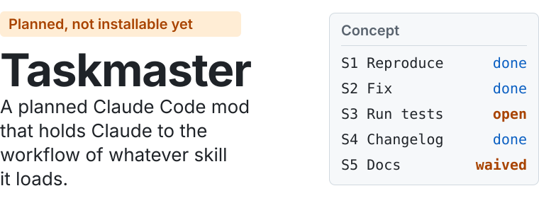
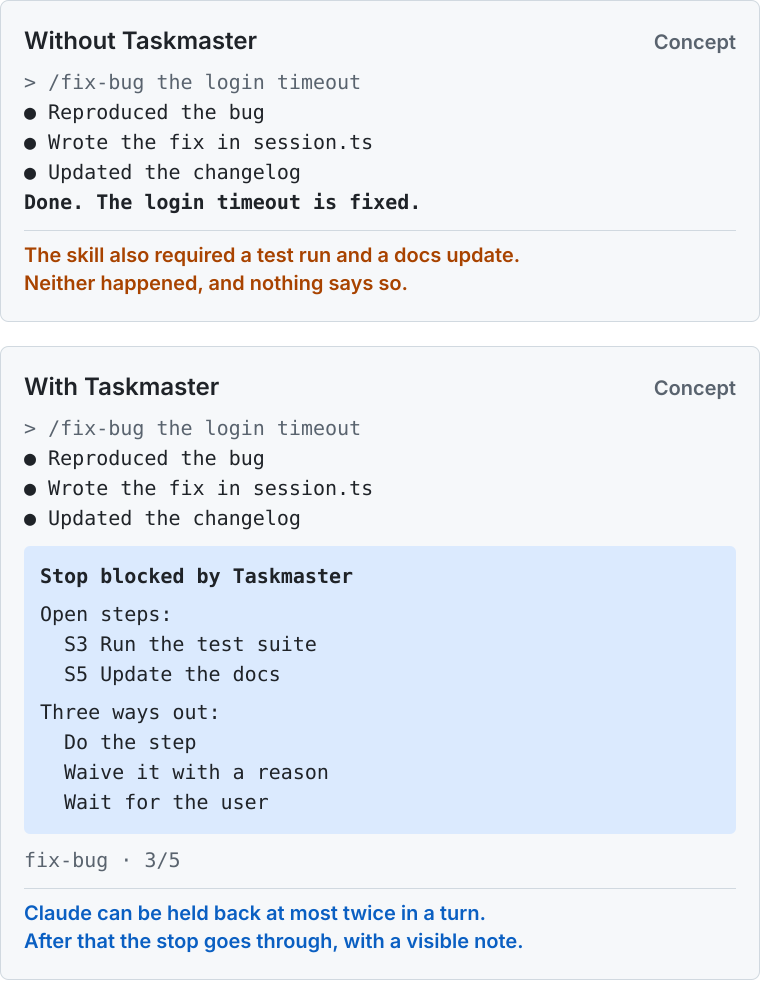
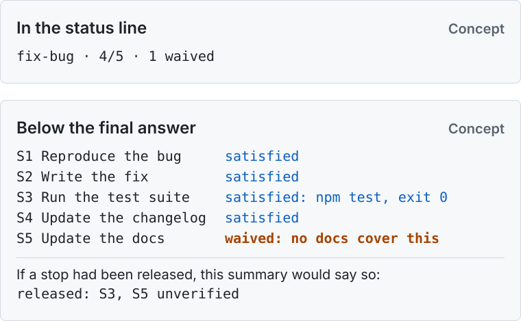
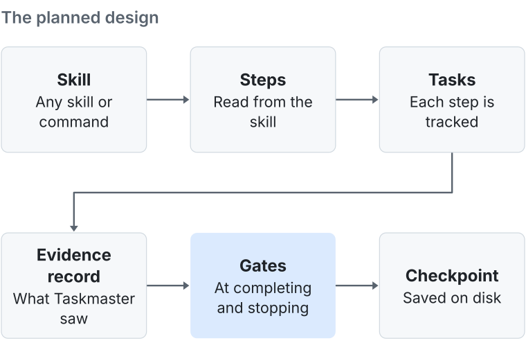
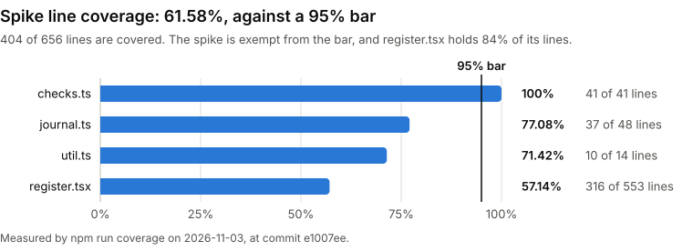

# <picture><source media="(prefers-color-scheme: dark)" srcset="docs/assets/hero-dark.svg"></picture>

**Planned, not installable yet.** Taskmaster is a planned Claude Code mod that holds Claude to the workflow of whatever skill it loads. It isn't built, and there's no install command. This repository holds its design and a Phase 0 spike that tested whether the design can work. That go/no-go check, Gate A, passed on 2026-11-03, so the first version (Phase 1) is next. Everything below describes what's planned.

Taskmaster's promise: Claude never silently skips a declared step, never claims completion without matching evidence, and never loses its place across compaction or a new session.

## The problem

A skill tells Claude what to do, but nothing holds Claude to it. If you use skills or slash commands, you may have seen Claude skip a required step, or say "done" without running the check. These failures come in four kinds, and Taskmaster only helps with some of them.

| When Claude... | Does Taskmaster help? |
| --- | --- |
| Skips steps the skill requires | **Yes.** Open steps hold up the end of the turn. |
| Claims "done" without doing or checking the work | **Yes.** Completing a task is checked against Taskmaster's own record. |
| Does work nobody asked for | **Partly,** through warnings. |
| Breaks a skill's MUST or NEVER rules | **Mostly no.** These are surfaced and audited, not enforced. |

## The same skill run, with and without it

<picture>
  <source media="(prefers-color-scheme: dark)" srcset="docs/assets/before-after-dark.svg">
  
</picture>

This is a concept, not a screenshot, and `fix-bug` is a made-up skill with five steps. Without Taskmaster, Claude says "done", and the test run and docs update were silently skipped. With it, the stop is blocked and the open steps are listed. Claude then has three ways out: do the step, waive it with a reason, or wait for the user.

## Why you'd want it

### Declared steps don't quietly vanish

Taskmaster reads the steps from the skill and tracks them as tasks. Claude can't end its turn with required steps open more than twice. After that the stop goes through, with a visible note.

**You'd see:** `released: S3, S5 unverified`

### "Done" needs evidence

Taskmaster keeps its own record of commands, errors and edits, and doesn't rely on what Claude says. A task can't complete with no recorded work, or without its verify command passing after the last edit, so `echo PASS` doesn't count.

**You'd see:** a refusal that reads `completed with no recorded work` and says how to waive the step.

### Skipping happens out loud

Claude can skip a step only by recording a reason, and every skip is shown to you.

**You'd see:** `fix-bug · 4/5 · 1 waived` in the status line, with the reason in the summary below the answer.

### It keeps its place

Checkpoints and a HANDOFF.md are saved on disk, so a run can survive compaction or a brand-new session. Resuming is offered, not forced.

**You'd see:** `Unfinished run: fix-bug 4/5 · /taskmaster resume`

### It works with the skills you already have

No configuration is needed. It enforces when it's confident of the steps, only advises when it isn't, and leaves reference skills alone. Skill authors can add optional `taskmaster:` frontmatter, and an advisor can recommend it.

**You'd see:** the skill's steps in the status line with no setup, marked `enforce` or `advisory`.

### You stay in charge

`/taskmaster off` and Esc always win, Stop blocks are capped, and the Stop gate fails open so it can't trap a session. Status appears in the status line and in a summary below the final answer.

<picture>
  <source media="(prefers-color-scheme: dark)" srcset="docs/assets/status-summary-dark.svg">
  
</picture>

**Worth knowing:** by default it commits checkpoints to git, as `taskmaster: checkpoint ...` commits. Those checkpoints include your original request, Claude's decisions and the commands it ran. Secrets are redacted first, but the rest goes wherever your next `git push` sends it, so on a public repository anyone can read it. Before its first commit in a repository with a public or unknown remote, it tells you this once. Set `checkpointGit: ignore` to keep checkpoints out of git. Metrics are committed alongside them but store no raw prompts or code, and the only place Taskmaster sends them itself is a webhook you set.

## How it works

<picture>
  <source media="(prefers-color-scheme: dark)" srcset="docs/assets/flow-dark.svg">
  
</picture>

A skill's steps become tasks. Taskmaster records what happens, checks that record at its gates, and saves a checkpoint so a new session can pick up the run. Four rules make that useful:

1. The plan comes from the skill, not from the model doing the work.
2. Evidence is what Taskmaster saw, not what Claude says.
3. Gates sit where Claude commits: marking a task completed, and stopping.
4. Skipping is allowed, but only out loud.

## What it doesn't do

- It doesn't make Claude work harder or think better. No hook raises reasoning quality.
- It doesn't check whether the work is correct, only that declared steps happened and their verify commands passed.
- It doesn't stop a determined model from gaming the gates. The goal is visible skipping, not perfect prevention.
- It doesn't enforce a skill's MUST or NEVER rules.
- It doesn't decide whether a conditional step ("if X, then...") applies to your request.
- It covers skills and commands, not plugins that are only hooks, MCP tools or agent definitions.

## Status and roadmap

| Stage | What it holds | State |
| --- | --- | --- |
| Phase 0: spike | An observe-only mod with one-shot probes that tests whether the design can work | Built. Gate A passed (GO, 2026-11-03) |
| Phase 1: first version | Steps from the skill, the evidence record, gates on completing or deleting a task and on stopping, recorded skips, checkpoints and resume, the status line and summary, metrics, and the frontmatter advisor for one skill | Planned, and next ([task list](docs/phase-1-tasks.md)) |
| Phase 2 onward | Holding Claude to a plan before it writes, subagent enforcement, warnings for unrequested work, an advisory audit, a side pane, and marketplace install | Planned |

The thresholds in the design plan are targets for a later trial, not results.

## For contributors

### Prerequisites

- The Claude Code CLI. CI pins 2.1.317, the build the spike was checked against.
- Node.js 22 or later and npm, for the coverage tools only. CI uses Node.js 24.

### Run the spike

Run these from the repository root.

1. Run the spike's tests. The last lines give the pass and fail counts.

   ```bash
   claude plugin test spike/taskmaster-spike
   ```

2. Start a session with the spike loaded.

   ```bash
   claude --plugin-dir ./spike/taskmaster-spike
   ```

3. In that session, run `/tm-spike status` to list the Gate A checks. The [runbook](spike/taskmaster-spike/RUNBOOK.md) covers the full run.

### Develop a mod

Mods are written test-first. [`CLAUDE.md`](CLAUDE.md) has the order to work in and the commands.

Changes reach the default branch through a pull request, and the `mod-coverage` check must pass. It requires passing tests, a passing `claude plugin validate`, and at least 95% line and function coverage for each mod. Branch coverage is printed but not required. To run the coverage step locally:

```bash
npm ci
npm run coverage
```

It prints `PASS`, `FAIL` or `EXEMPT` for each mod with its line and function coverage, and exits 1 if any mod fails.

A mod listed in [`coverage-exempt.json`](coverage-exempt.json) is excused from the percentage, but its tests must still pass. The spike is listed there because it predates the bar.

The `mod-coverage` check runs from the pull request's own files, so a separate `gate-guard` check fails any pull request that changes the gate's own files: `coverage-exempt.json`, `package.json`, `package-lock.json`, `npm-shrinkwrap.json`, `.npmrc`, `scripts/`, `.github/workflows/` and Claude Code's project settings. It runs from the base branch, so a pull request can't change it for itself. To change the gate on purpose, the repository owner lifts that check in the ruleset for the merge.

Claude Code's project settings also deny Claude edits to those files and `gh pr merge`. Those rules cover the commands Claude normally writes, so treat them as a guard rail, not a security boundary.

The gate reads its numbers from what tests print, so a test written to print fake counters would pass. Review changes to tests with that in mind.

<picture>
  <source media="(prefers-color-scheme: dark)" srcset="docs/assets/spike-coverage-dark.svg">
  
</picture>

<details>
<summary>The chart's numbers as a table</summary>

| File | Line coverage | Lines covered |
| --- | --- | --- |
| `checks.ts` | 100% | 41 of 41 |
| `journal.ts` | 77.08% | 37 of 48 |
| `util.ts` | 71.42% | 10 of 14 |
| `register.tsx` | 57.14% | 316 of 553 |
| All spike code | 61.58% | 404 of 656 |

</details>

## Documentation

- [Design plan](docs/taskmaster-plan.md): the features, the build order and the go/no-go gates.
- [Spike runbook](spike/taskmaster-spike/RUNBOOK.md): how to run each probe and read its result.
- [Gate A checklist](spike/taskmaster-spike/GATE-A-TASKS.md): the spike's finished run, with the evidence for each check. The result is in plan §10.1.
- [Phase 1 task list](docs/phase-1-tasks.md): the tasks for the first version, in build order.
- [`CLAUDE.md`](CLAUDE.md): commands, architecture and the test-first workflow.
- [Changelog](CHANGELOG.md): notable changes.

## License

[MIT License](LICENSE).
